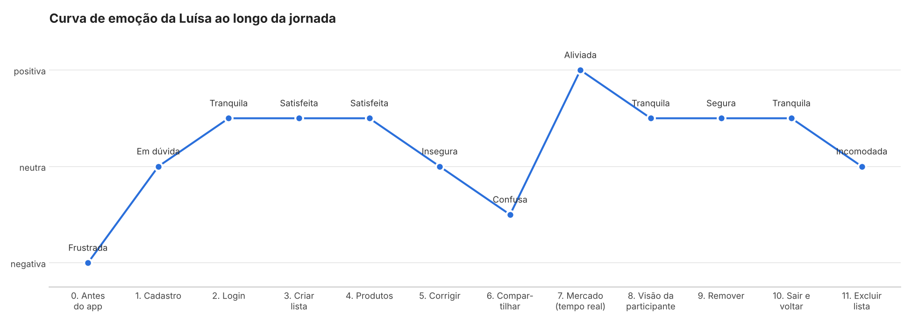

# Jornada do usuário

Vídeo: https://youtu.be/Wh0kgWeWqeM

## Persona
| Campo | Persona |
|---|---|
| Nome e idade | Luísa, 21 anos |
| Ocupação | Estudante de Engenharia na UnB, faz estágio 3x por semana |
| Contexto | Mora numa república em Brasília com duas colegas, Paula e Ana. As três dividem as compras da casa |
| Problema | Anotam o que falta no grupo do WhatsApp; a lista se perde na conversa, itens são esquecidos ou comprados em dobro, e ninguém sabe o que já foi comprado |
| Objetivo com o app | Ter uma lista única da casa, que as três editam e que mostra na hora o que já foi comprado |
| Familiaridade com tecnologia | Média: usa computador e celular todo dia, quer algo simples |
| Como usaria | Durante a semana, quem lembra de algo adiciona na lista; quem vai ao mercado marca os itens ali mesmo |

## Jornada

| Etapa | Objetivo | Ação | Resposta do app | Sentimento | Dificuldade |
|---|---|---|---|---|---|
| 0. Antes do app | Combinar as compras da casa | Anota o que falta no grupo do WhatsApp | — | Frustrada | Não sabe o que já foi comprado nem o que falta; itens são esquecidos |
| 1. Cadastro | Criar uma conta | Clica em "Cadastrar-se", preenche nome, usuário e senha, clica em "Cadastrar" | Volta para a tela "Entrar" | Em dúvida | Não aparece mensagem de sucesso; fica na dúvida se a conta foi criada |
| 2. Login | Entrar na conta | Digita usuário e senha, clica em "Entrar" | Abre "Minhas listas" com "Olá, Luísa" e "Você ainda não tem listas." | Tranquila | — |
| 3. Criar lista | Ter um lugar único para as compras | Digita "Mercado da República" → "+ Criar" | A lista aparece com "Dono: luisa" e "Participantes (1)" | Satisfeita | — |
| 4. Produtos | Anotar o que falta | Abre a lista → adiciona produto e quantidade → "+ Adicionar" | Itens aparecem com a etiqueta "falta"; barra mostra "0 de N itens comprados" | Satisfeita | Precisa adicionar um produto por vez |
| 5. Corrigir | Ajustar quantidade e tirar item | Leite → "editar" → muda a quantidade → "Salvar"; Detergente → "excluir" | A tabela atualiza | Insegura | Excluir produto não pede confirmação; tem medo de apagar o item errado |
| 6. Compartilhar | Colocar as colegas na lista | Bolinha "+" → digita usuário errado → depois "paula" e "ana" → "Adicionar" | Usuário errado: "Esse usuário não existe."; certos: bolinhas P e A aparecem | Confusa | Precisa saber o nome de usuário exato de cada colega; o app não sugere nomes |
| 7. Mercado (tempo real) | Saber o que já foi comprado | Paula, em outra janela, abre a lista, clica nos itens e adiciona um que lembrou | Na tela da Luísa, sem recarregar: etiquetas viram "comprado", barra sobe, item novo aparece, até "Tudo comprado!" | Aliviada | — |
| 8. Visão da participante | Entender o que cada uma pode fazer | Na janela da Paula, abre o "+" e olha o fim da folha | Paula não vê "Remover"; vê "Sair da lista" | Tranquila | — |
| 9. Remover | Tirar quem saiu da república | Luísa → "+" → "Remover" ao lado de ana → confirma | Pede confirmação; a bolinha A some nas duas janelas | Segura | — |
| 10. Sair e voltar | Encerrar e voltar depois | "Sair"; entra de novo | Volta para "Entrar"; ao entrar, a lista continua igual | Tranquila | A sessão dura 1 hora; se deixar a página aberta por mais tempo, precisa entrar de novo |
| 11. Excluir lista | Fechar a compra do mês | "Excluir" na lista → confirma → cria "Mercado de dezembro" | Pede confirmação; a lista some; a nova aparece | Incomodada | Não dá para reaproveitar os itens da lista anterior; o histórico é apagado |

## Curva de emoção

A Luísa começa frustrada com a lista no WhatsApp e melhora logo no cadastro e no login. A primeira queda acontece ao corrigir produtos, porque a exclusão não pede confirmação. A maior queda é ao compartilhar: ela precisa saber o usuário exato de cada colega. O ponto mais alto é no mercado, quando vê os itens marcados pela Paula aparecerem na hora. No fim, a emoção cai um pouco porque a lista excluída não pode ser reaproveitada.

## Principais dificuldades

- **Compartilhar:** é preciso digitar o nome de usuário exato; um erro de digitação gera "Esse usuário não existe."
- **Excluir produto:** não há confirmação, então um clique errado apaga o item.
- **Cadastro:** não há mensagem confirmando que a conta foi criada.
- **Nova lista a cada mês:** os itens da lista anterior não podem ser reaproveitados.
